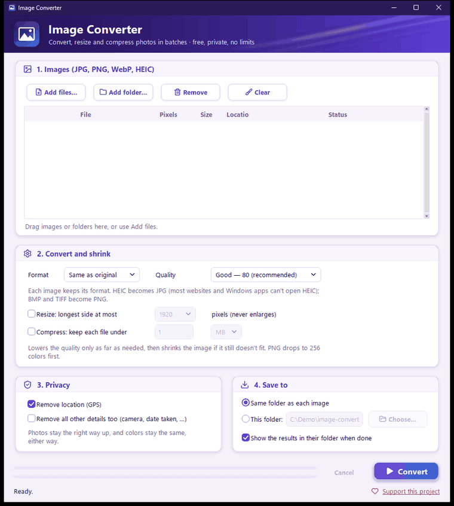

# Image Converter

**Free, offline alternative to online image converters and compressors. No 20-image limit, no uploads, no account.**



Converts, resizes and compresses photos in batches: **HEIC, WebP, PNG and JPG**. Drag in as
many as you like, set a maximum size or a file-size limit, and it removes the location data
your phone hid in them. Your photos never leave your computer. Works on Windows and macOS.

## Download
Get the latest version from the [Releases page](https://github.com/collinb0607/image-converter/releases/latest).
Nothing else to install.

| Your computer | Download | First launch |
|---|---|---|
| Windows 10/11 | `Image-Converter-Windows.exe` | Windows may show "Windows protected your PC" because the app isn't signed. Click **More info**, then **Run anyway**. The first start takes a few seconds. |
| Mac with Apple Silicon (M1 or newer) | `Image-Converter-macOS.zip` | Unzip, then open **Image Converter**. macOS blocks it the first time because the app isn't notarized: open **System Settings → Privacy & Security**, scroll down and click **Open Anyway**. |

On an Intel Mac, or any other system, run it from source with Python (below).

## How it works
- **Drag and drop.** Drop images or whole folders anywhere on the window (a folder adds the
  images directly inside it), or use **Add files** / **Add folder**. Each image shows its size in
  pixels, its file size, and whether it contains a location.
- **Compress to a size limit.** Set a limit like 500 KB or 2 MB and every image lands just under
  it. For JPG and WebP it lowers the quality only as far as needed; if even a low quality is too
  big, it keeps a decent quality and shrinks the image instead, to the largest size that fits.
  PNG is lossless, so it first reduces the image to 256 colors (like TinyPNG: screenshots and
  graphics usually look the same), then shrinks it if needed.
- **Location removed.** Phones save where each photo was taken. That's removed by default, from
  the EXIF data and from XMP. Camera model and date taken stay, unless you also tick **Remove all
  other details**.
- **Photos stay right.** Sideways phone photos are turned upright for real, so they still show
  the right way round with the rotation tag gone. Color profiles are kept, so colors don't shift.
- **Never makes a file bigger for nothing.** If re-saving an image in its own format, at its own
  size, would make it larger (it was already well compressed), the original image data is kept
  and only its metadata is cleaned.
- **Safe with your files.** It never overwrites the original: compressing `photo.jpg` to JPG in the
  same folder makes `photo (compressed).jpg`. If outputs already exist it asks once for the whole
  batch: replace, skip those, or stop. Each file is written under a temporary name and renamed when
  it's finished, so Cancel or a crash never leaves half a file. Several images are converted at
  once, using more of your CPU.

## Options
| Option | What it does |
|---|---|
| Format | **Same as original** (HEIC becomes JPG, since most websites and Windows apps can't open HEIC; BMP and TIFF become PNG), **JPG**, **PNG** or **WebP**. Transparent areas become white in JPG. |
| Quality | For JPG and WebP: High (90), **Good (80, recommended)** or Smaller (65). With a size limit, this is the highest quality it will use. |
| Resize | Longest side at most 3840, 2560, 1920, 1280, 1080… pixels, or type your own. Never enlarges. |
| Compress | Keep each file under a size, in KB or MB (1 MB = 1,000,000 bytes, so it also fits sites that count 1 MB as 1,048,576). |
| Privacy | **Remove location (GPS)**: on by default. **Remove all other details too**: camera, lens, date taken, comments, and so on. |
| Save to | Next to each original, or all in one folder. Two inputs with the same name (e.g. `a.png` and `a.heic` both to JPG) become `a.jpg` and `a (2).jpg`. |

## Run from source (Python)
### Setup (one time)
1. Install **Python 3.8+** from https://python.org. On Windows, tick **"Add Python to PATH"** during install.
2. Run the app (see below). The first time, it asks to install **Pillow**, **pillow-heif** (for HEIC)
   and **tkinterdnd2** (for drag and drop). Click **Yes**; it's about a 15 MB download. You won't
   be asked again.

### Run
```
python image_converter.py        # Windows
python3 image_converter.py       # macOS
```
On Windows you can also double-click `image_converter.py`. If you have more than one Python
installed, double-clicking can run a different one from `python` in a terminal, so it may ask to
install the components once more. The install dialog shows which Python it installs into.

## Troubleshooting
- **"Can't get it that small":** the size limit is too small for that image even at a few dozen
  pixels wide. Use a bigger limit.
- **An animated WebP or PNG became a still image:** only the first frame is converted.
- **The output is bigger than the original:** this happens when converting to a less efficient
  format (HEIC → JPG, or a photo → PNG). Turn on **Compress** to set a limit.
- **Drag and drop doesn't work:** use **Add files** / **Add folder**. When running from source,
  check that `tkinterdnd2` is installed.
- **Something fails with no message:** errors are also written to `image_converter_errors.log`
  in your temp folder. On Windows, paste `%TEMP%\image_converter_errors.log` into File Explorer's
  address bar. On Mac, run `open $TMPDIR/image_converter_errors.log`.

## Support this project
This app is free, with no ads, accounts or limits. If it saved you time or a subscription, you can
support its development on Ko-fi:

[](https://ko-fi.com/collinbrooksdev)

## Part of the Offline Toolkit
Also by me: [GIF Maker](https://github.com/collinb0607/gif-maker), which turns a video into a GIF,
animated WebP, MP4 or WebM; [Video Compressor](https://github.com/collinb0607/video-compressor),
which shrinks a video to fit Discord's upload limit or an email attachment; and
[Audio Converter](https://github.com/collinb0607/audio-converter), which pulls the sound out of
videos to MP3 or WAV and evens out loudness.
